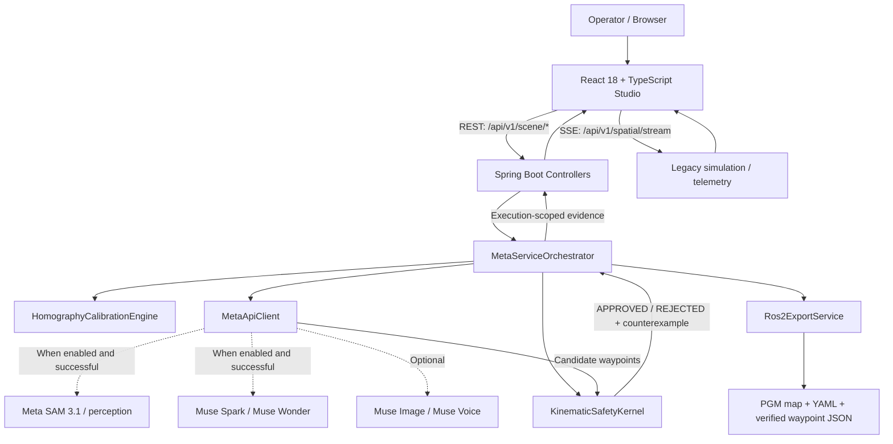
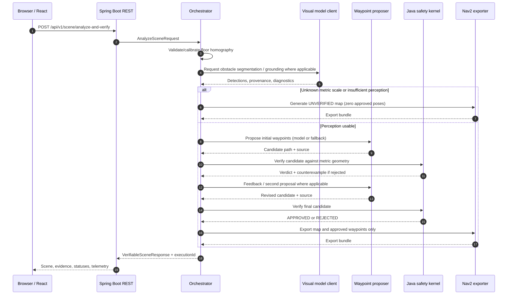

# KineGuard ROS2 Studio

**A verifiable navigation-proposal pipeline for camera-based robot-navigation experiments.**

**AI proposes. Physics decides.**

[](#technology-stack)
[](#technology-stack)
[](#technology-stack)
[](#technology-stack)
[](#ros-2-nav2-export)
[](#scope-and-non-goals)

**Meta Global AI Developer Hackathon 2026 · Indie Developer Track · Push the Frontier**

**[Watch the submitted 2:23 demo](https://youtu.be/r1-wLSol0Bg)** · **[Source repository](https://github.com/Briansalazarh/KineGuard-ROS2-Studio)**

> **Engineering status:** This repository is a research/prototyping environment, **not** a production robot-navigation stack or a certified functional-safety system. It produces navigation *artifacts*; it does not drive ROS 2 hardware, execute the `FollowWaypoints` action, or establish end-to-end collision avoidance in the physical world. Some scenes and results use explicitly labeled demonstration or deterministic fallback data.

---

## 🚀 Quick Live Demo — Judge Evaluation Guide

### 🌐 Launch the Interactive Application

**[▶ OPEN KINEGUARD ROS2 STUDIO — LIVE DEMO](https://kine-guard-ros-2-studio.vercel.app)**

**No installation, local environment setup, account, or personal Meta API key required.**

The public deployment connects:

- **Frontend:** React 18 + TypeScript + Vite, hosted on Vercel.
- **Backend:** Java 21 + Spring Boot 3.3, hosted on Railway.
- **AI:** Meta Model API — SAM 3.1 and Muse Spark 1.3.
- **Safety:** Deterministic kinematic verification with counterexample-guided replanning.
- **Output:** ROS 2 Nav2 occupancy maps and verified metric waypoints.

Live Meta inference is available while the evaluation deployment and API credentials remain enabled.

### Test 1 — Live AI Planning and Safety Verification

**Recommended first test.**

1. Open the [live application](https://kine-guard-ros-2-studio.vercel.app).
2. Select **Warehouse Logistics Spine A**.
3. Keep the default corridor calibration, the `"box"` concept, and **Muse Spark 1.3 (Fast Agent)**.
4. Click **RUN FULL VERIFIABLE PIPELINE (SAM 3.1 + TOOL LOOP)**.
5. Allow the pipeline to complete. Execution may take tens of seconds depending on API latency.
6. Inspect **Verifiable Agent Tool-Calling Loop**, **Metric Top-Down Nav2 Occupancy Grid**, and **Pipeline Stream**.

**Expected behavior:**

1. **SAM 3.1** detects and localizes obstacles through Meta Model API.
2. **Muse Spark 1.3** proposes an initial robot trajectory.
3. **KinematicSafetyKernel** checks stopping distance and obstacle clearance.
4. An unsafe path is **REJECTED**, with a geometric counterexample.
5. Muse Spark replans using the verifier's feedback.
6. The corrected trajectory is approved only if the safety constraints pass.
7. The ROS 2 Nav2 compiler exports the occupancy grid and verified waypoints.

**Observed production result — November 5, 2026:**

| Component | Result |
|---|---|
| SAM 3.1 | LIVE API HTTP 200 — approximately 1.61 s |
| Muse Spark — Turn 1 | LIVE API HTTP 200 — approximately 5.20 s |
| Muse Spark — Turn 2 | LIVE API HTTP 200 — approximately 7.62 s |
| Initial minimum clearance | 0.00 m — REJECTED |
| Required lateral clearance | 0.47 m |
| Corrected minimum clearance | 0.82 m — APPROVED |
| ROS 2 Nav2 export | 80 × 120 cells at 0.05 m/cell; 4 verified waypoints |

**Key engineering principle:** The AI proposes candidate trajectories; the deterministic kinematic safety kernel has final authority over approval.

---

### Test 2 — Upload Your Own Image (Live SAM 3.1 + Metric Calibration)

**Important: This capability was successfully tested with a real uploaded warehouse image. Follow the calibration instructions below to reproduce it.**

1. Click **Upload Photo** in the **REAL-WORLD CORRIDOR FEED** panel.
2. Select an image of a warehouse aisle, industrial corridor, or similar environment with visible obstacles.
3. Confirm that the uploaded photograph appears under **USER PHOTO + SAM 3.1 & HOMOGRAPHY**.
4. In the right-hand panel **PHYSICAL KINEMATICS & META MODEL API CONTROLS**, find **Corredor (m) — foto subida**.
5. Set the corridor dimensions to the dimensions appropriate for your image. For the supplied 4 m × 6 m demonstration example, use:
   - **Ancho (m):** `4`
   - **Largo (m):** `6`
6. **CRITICAL — Open the scale dropdown immediately below these fields.** Select **"Escala nominal — dimensiones asumidas"** (`NOMINAL_ASSUMED`) if you are intentionally testing with assumed corridor dimensions.
7. Inspect the four draggable floor calibration points **P0–P3** and align them with the corresponding floor corners if necessary.
8. Keep the `"box"` concept selected and click **RUN FULL VERIFIABLE PIPELINE (SAM 3.1 + TOOL LOOP)**.
9. Inspect the detected obstacles, projected occupancy grid, tool-calling loop, verification status, and ROS 2 output.

**Why step 6 matters:** An uploaded image without an established metric scale is treated as `SCALE: UNKNOWN`. Even if SAM 3.1 detects an obstacle, KineGuard will halt verification with `UNVERIFIED` and export zero approved navigation poses rather than claim an unverified metric trajectory is safe.

The **NOMINAL_ASSUMED** setting explicitly enables a scenario evaluation using assumed dimensions. It is not a substitute for measured, validated calibration in a physical robot deployment.

**Observed uploaded-image test — November 5, 2026:**

- Live SAM 3.1 detected a warehouse box.
- Detections whose ground-contact points were outside the calibrated corridor were rejected.
- With unknown scale, the system returned `UNVERIFIED` and zero approved poses.
- With the nominal 4 m × 6 m corridor assumption selected, the live pipeline completed its planning and verification process.
- The corrected trajectory reached `APPROVED`.
- ROS 2 Nav2 export generated an 80 × 120 occupancy grid and four verified metric waypoints under the assumed calibration.

This demonstrates both successful image-based operation and the system's conservative behavior when essential calibration information is missing.

**Safety limitation:** `APPROVED` means the calculated trajectory satisfies the implemented verifier under the supplied geometry, perception results, and physical assumptions. It does not constitute certification for autonomous operation in an uncontrolled real-world environment.

---

### Inspect and Export the Results

The interactive interface exposes:

- **SAM 3.1 perception:** detected obstacles and image-to-floor projection.
- **3×3 projective homography:** image coordinates mapped into a metric floor representation.
- **Multi-turn tool-calling:** rejected and corrected trajectories with verification evidence.
- **Kinematic verification:** stopping distance, clearance thresholds, and counterexamples.
- **ROS 2 Nav2 artifacts:** downloadable `.pgm`, `.yaml`, and `.json` outputs.
- **Pipeline Stream:** execution IDs, model-call status, decisions, and verification logs.

Click **Export ROS 2 Nav2 Package (.pgm + .yaml + .json)** to inspect the generated navigation artifacts.

### Reproducibility and Execution Modes

KineGuard supports both live Meta Model API execution and deterministic offline demonstrations.

- **`LIVE_META_API` / `SAM_LIVE` / `LLM_TOOL_CALL`:** Indicate live-model execution in the relevant pipeline stages.
- **`OFFLINE_DETERMINISTIC` / `MOCK_SCRIPTED`:** Indicate deterministic or scripted demonstration paths.
- **`UNVERIFIED`:** Required verification evidence is insufficient; no trajectory is authorized.

Offline results must not be represented as live Meta inference. The evaluation deployment may temporarily fall back to offline behavior when live API access is unavailable.

**The project demonstrates AI-assisted robotic navigation planning with independent safety verification, not physical robot execution.**


---

## Contents
1. [Quick live demo — Judge evaluation guide](#-quick-live-demo--judge-evaluation-guide)
2. [Executive summary](#executive-summary)
3. [The problem, and why this is not a replacement for Nav2](#the-problem-and-why-this-is-not-a-replacement-for-nav2)
4. [What KineGuard actually does](#what-kineguard-actually-does)
5. [Architecture](#architecture)
6. [End-to-end pipeline](#end-to-end-pipeline)
7. [Mathematical foundations and safety checks](#mathematical-foundations-and-safety-checks)
8. [Model integration and evidence provenance](#model-integration-and-evidence-provenance)
9. [ROS 2 Nav2 export](#ros-2-nav2-export)
10. [Frontend and visualization](#frontend-and-visualization)
11. [Technology stack](#technology-stack)
12. [Getting started](#getting-started)
13. [API reference](#api-reference)
14. [Testing and reproducibility](#testing-and-reproducibility)
15. [Project structure](#project-structure)
16. [Operational behavior and troubleshooting](#operational-behavior-and-troubleshooting)
17. [Security, correctness and limitations](#security-correctness-and-limitations)
18. [Research questions and roadmap](#research-questions-and-roadmap)
19. [Hackathon submission and acknowledgments](#hackathon-submission-and-acknowledgments)

---

## Executive summary

KineGuard is a small, inspectable experiment in **separating candidate action generation from independent physical constraint checking**. An operator selects a predefined corridor scene or uploads an image, declares the corridor dimensions and floor calibration points, and starts an explicit processing run. The backend can obtain obstacle proposals from Meta's visual-model interfaces, project obstacle geometry onto a calibrated ground plane, ask a reasoning model for navigation waypoints, and verify those waypoints with a deterministic Java kernel. Only a trajectory that passes the configured checks is eligible to appear in the exported waypoint list.

The experiment is motivated by a specific systems-design question:

> Can a model-generated robot-navigation proposal be treated as **untrusted input**, with explicit provenance, a deterministic acceptance boundary, actionable rejection feedback, and artifacts tied to the exact verification run?

The repository implements that boundary. It does **not** establish that LLM waypoint generation is faster, safer, cheaper, more reliable, or more useful than established robotic motion-planning algorithms. This distinction is intentional.

### Core capabilities

| Area | Implemented behavior | Important qualification |
| --- | --- | --- |
| Scene input | Built-in warehouse/cold-chain/cleanroom-style presets and user-uploaded images | Preset scenes contain known geometry; they are not evidence of live segmentation |
| Calibration | Four-point planar homography between camera pixels and metric floor coordinates | Metric accuracy depends on the supplied physical dimensions and correct ground-plane points |
| Perception | Meta-oriented SAM 3.1 segmentation and optional Muse-assisted grounding | Live responses may fail or be invalid; result provenance and failure status are exposed |
| Proposals | Tool-call-shaped waypoint proposals and a two-turn verification/replanning flow | A run may use model output, deterministic fallback, or offline scripted candidates |
| Physical checks | Wall bounds, obstacle clearance, directional braking clearance, speed/friction validation | Simplified geometric/kinematic checks, not full vehicle dynamics or safety certification |
| Failure reporting | Rejected trajectories contain the conflicting segment, obstacle, and explanatory counterexample | A rejection is evidence of constraint violation under the configured model |
| Export | ASCII PGM occupancy grid, map metadata, costmap parameters, and waypoint JSON | File-format compatibility does not equal integration with or deployment to a ROS 2 robot |
| UI | Dual spatial viewports, execution status, logs, telemetry, export controls | Route animation is visualization of approved waypoints, not hardware motion |
| Modes | Live Meta configuration and deterministic offline/test behavior | Configuration of a key alone does not prove a particular execution used live inference |

### Why build an explicit verification boundary?

A probabilistic planning component can output syntactically valid coordinates that collide with a known obstacle or exceed a simplified braking constraint. The kernel can reject those coordinates independently of the model's explanation or confidence. That is a useful architectural pattern **in principle**. Its practical value over a conventional navigation stack remains an open engineering question that requires benchmarking and a real deployment target.

---

## The problem, and why this is not a replacement for Nav2

Robot navigation already has strong conventional approaches: grid-search planners, sampling-based motion planning, local trajectory optimization, costmaps, state estimation, and hardware-facing ROS 2 components. These methods should generally remain the default for geometric route planning. Calling a cloud LLM to propose a handful of `(x, y)` coordinates is **not** a demonstrated improvement over those methods.

KineGuard therefore should not be read as a claim that generative AI has solved ordinary path planning. It explores a narrower interface: **what happens when an AI-produced proposal is fed into a deterministic validator, and how can the rejection or acceptance be represented, tracked, and exported?**

This distinction changes the correct evaluation criterion. The current repository can illustrate provenance, fail-closed handling, geometric validation, counterexample feedback, and export discipline. To establish real-world product value, future work would need to compare it against a Nav2-only baseline under measured conditions: time to produce a valid route, collision rate, clearance, robustness to perception failures, recovery behavior, computational cost, and operator effort.

### Scope and non-goals

**In scope:** a calibrated planar scene, a bounded corridor, obstacle footprints represented in metric coordinates, waypoint proposals, deterministic verification, reproducible preset scenarios, adversarial demonstrations, and navigation-file generation.

**Out of scope today:** robot localization, dynamic obstacle tracking, obstacle prediction, multi-sensor fusion, closed-loop motion control, actuation, robot-specific kinematic models, formal verification of arbitrary real-world dynamics, hardware safety certification, autonomous operation in occupied workplaces, and proof of superiority to established planners.

An `APPROVED` result has a **local and conditional** meaning: the particular proposed waypoints satisfied the rules and scene representation used by `KinematicSafetyKernel`. It must not be interpreted as a universal assertion that a physical robot can safely execute them.

---

## What KineGuard actually does

The application has two closely related, but different, subsystems:

1. **The verifiable metric-scene pipeline.** This is the primary hackathon workflow: calibrated image → obstacle representation → candidate waypoints → independent verification → conditional ROS 2 export. Its entry points are `/api/v1/scene/analyze-and-verify` and `/api/v1/scene/red-team`.
2. **A legacy spatial/fleet simulation subsystem.** `ChaosSimulationEngine`, `VoronoiSpatialEngine`, and `/api/v1/spatial/*` expose continuously updated telemetry and simulation behavior. Legacy chaos and voice-command endpoints remain in the codebase. This subsystem should not be confused with a physical ROS 2 fleet or with execution of the exported Nav2 route.

The React application presents both the verifiable pipeline and telemetry in a single studio. It begins with a selected preset in an **idle** state. The potentially expensive scene-analysis pipeline starts only after a deliberate user action, rather than automatically when React mounts.

---

## Architecture



**Trust boundary:** model outputs and fallback proposals are **candidates**. `KinematicSafetyKernel` produces the acceptance decision. Export receives the final verification report; it does not use a language-model statement such as “safe” as authorization.

**Source map:**

| Responsibility | Main source |
| --- | --- |
| Main application | `backend/src/main/java/com/vanguard/VanguardApplication.java` |
| Pipeline orchestration | `backend/src/main/java/com/vanguard/meta/MetaServiceOrchestrator.java` |
| Model HTTP transport, parsing and fallback | `backend/src/main/java/com/vanguard/meta/MetaApiClient.java` |
| Calibration | `backend/src/main/java/com/vanguard/engine/HomographyCalibrationEngine.java` |
| Verification | `backend/src/main/java/com/vanguard/engine/KinematicSafetyKernel.java` |
| Navigation export | `backend/src/main/java/com/vanguard/engine/Ros2ExportService.java` |
| REST endpoints | `backend/src/main/java/com/vanguard/controller/VoiceChaosController.java` |
| Simulation/SSE | `backend/src/main/java/com/vanguard/controller/SpatialSimulationController.java` |
| API contracts | `backend/src/main/java/com/vanguard/domain/dto/MetaApiDtos.java` |
| Browser app | `frontend/src/App.tsx` |
| Network client | `frontend/src/services/api.ts` |
| Dual visualization | `frontend/src/components/DualSpatialViewports.tsx` |
| Agent-loop inspector | `frontend/src/components/VerifiableAgentLoopPanel.tsx` |
| Scene fixtures | `frontend/src/utils/realScenePresets.ts` |

### Sequence of an analysis request



The orchestrator's current implementation records two verification turns when the normal planning stage is reached. The second turn may be a true model-originated proposal, a deterministic fallback, or offline scripted behavior; **two turns do not imply two successful LLM calls**.

---

## End-to-end pipeline

### 1. Establish an image and scene provenance

An operator selects `PRESET_SCENE` or `USER_UPLOAD`. Presets are rendered from local scene definitions and contain explicit, known bounding boxes. Uploaded images must supply their own perception result: the backend does **not** silently reuse a preset's boxes to make an uploaded photo appear successfully segmented.

The input declares corridor width and length, current velocity, friction coefficient, a visual concept prompt (for example, `box`), an operator directive, and a scale classification.

The four scale classifications are:

- `MEASURED_REFERENCE`: dimensions are intended to be based on an external physical reference.
- `NOMINAL_PRESET`: declared dimensions come from the named demonstration scene.
- `NOMINAL_ASSUMED`: dimensions are assumed, not independently measured.
- `UNKNOWN`: no trustworthy scale is available.

A declared type is **provenance metadata**, not evidence that calibration has been measured correctly. In particular, `NOMINAL_ASSUMED` and `NOMINAL_PRESET` must not be presented as ground-truth physical measurements.

### 2. Compute a planar homography

Four image points correspond to four known corners on a metric ground-plane rectangle. `HomographyCalibrationEngine` solves the planar projective transform and its inverse. It checks for invalid, collinear, self-intersecting, or non-convex calibration geometry.

The expected point order is near-left → near-right → far-right → far-left, mapped to the rectangle `(0,0)`, `(W,0)`, `(W,L)`, `(0,L)`.

The camera is modeled by a **single floor plane**. Objects above that plane cannot generally be metricized correctly by applying the same transform to arbitrary image pixels. The code uses the obstacle's lower / ground-contact region for its geometric interpretation and rejects detections outside the calibrated floor rather than forcibly shifting them inside.

### 3. Acquire obstacle proposals

`MetaApiClient` implements the perception-related HTTP transport and parsing paths, including SAM-oriented segmentation and optional visual grounding. Detection candidates are checked for validity and projected to metric polygons/footprints.

A perception result carries:

- `perceptionStatus`: `DETECTED`, `NO_DETECTIONS`, `INVALID_DETECTION`, or `PERCEPTION_ERROR`.
- `obstacleSource`: e.g. `SAM_LIVE`, `PRESET_DEMO`, or `NONE` (the red-team workflow can use `RED_TEAM_SYNTHETIC`).
- API call counts, timings, rejected-detection counts, notes, and raw result fields.

The distinction between `SAM_LIVE` and `PRESET_DEMO` is critical: a successful preset demonstration is **not** proof of a live image-segmentation call. When offline, known preset geometry can be used for reproducibility and remains labeled as such. An uploaded image with no valid detections is not silently “fixed” with those preset obstacles.

### 4. Produce candidate waypoints

The planning path is represented as metric waypoints, with tool-call-shaped arguments passed through `verify_kinematic_safety`. Configured Meta reasoning models may provide those arguments when live requests succeed. If they do not, code-defined deterministic candidates can be evaluated; offline runs use scripted mock candidates.

Every turn records where its candidate came from:

| `waypointSource` | Meaning |
| --- | --- |
| `LLM_TOOL_CALL` | The coordinates came from parsed model tool-call output |
| `DETERMINISTIC_FALLBACK` | The backend supplied a fallback path after an unavailable or unsuitable model proposal |
| `MOCK_SCRIPTED` | Offline/test-mode candidate; not a live model result |
| `NONE` | No accepted output path/source |

The same kernel checks all candidates. A successful deterministic fallback does not validate the LLM's planning ability; a successful live HTTP request does not automatically imply that the final accepted waypoints came from that request.

### 5. Reject or approve against configured constraints

The kernel checks finite numeric inputs, physical parameter bounds, waypoint count, corridor boundaries, and segment-to-obstacle geometry. It calculates a stopping-distance allowance and uses different lateral and forward-direction clearance requirements. On rejection, the report contains structured failure details for inspection and potential replanning.

If the scale is unknown or perception is insufficient, the orchestrator returns `UNVERIFIED` instead of permitting an `APPROVED` path. For a blocked corridor, a second proposal can remain `REJECTED`; the application does not need to invent an approved route.

### 6. Compile the export

`Ros2ExportService` generates the grid/map/waypoint payload. When the report is not `APPROVED`, its waypoint `poses` array is empty. Export packages are associated with an `executionId`, and the explicit ID lookup returns **404** if the ID is unknown instead of returning a different execution's bundle.

---

## Mathematical foundations and safety checks

The following equations describe the **simplified engineering model implemented here**, not a certified dynamics model.

### Projective geometry

Let a camera image point be represented in homogeneous coordinates by `p = [u, v, 1]^T`. The floor-plane transform maps it into metric homogeneous coordinates:

\[
\begin{bmatrix} X' \\ Y' \\ W' \end{bmatrix}
= H \begin{bmatrix}u\\v\\1\end{bmatrix},
\qquad
x = X'/W',\quad y = Y'/W'.
\]

Here, `H` is a calibrated `3 × 3` homography. The inverse transform maps metric points into the image plane for visualization. The four point correspondences determine the transform, provided the calibration geometry is non-degenerate.

**Assumptions:** planar floor, correct point ordering, stable perspective, meaningful width/length values, and correct ground-contact interpretation of obstacles. An inaccurate dimension or corner selection produces a correspondingly inaccurate metric map; a valid matrix is not proof of field calibration.

### Effective deceleration and stopping distance

Constants in `KinematicSafetyKernel`:

| Parameter | Value | Meaning |
| --- | --- | --- |
| `MAX_DECELERATION_MPS2` | `3.5 m/s²` | Maximum allowed deceleration used by the verifier |
| `ROBOT_RADIUS_METERS` | `0.32 m` | Circular robot footprint approximation |
| `REACTION_TIME_SEC` | `0.15 s` | Assumed reaction latency |
| `EXTRA_SAFETY_MARGIN_METERS` | `0.15 m` | Additional clearance |
| `g` | `9.81 m/s²` in configuration | Gravitational acceleration |

The effective deceleration is limited by the lesser of the configured deceleration cap and the friction-based bound:

\[
a_{\mathrm{eff}} = \min(3.5, \mu g).
\]

The modeled stopping distance is:

\[
d_{\mathrm{stop}} = v\,(0.15) + \frac{v^2}{2a_{\mathrm{eff}}}.
\]

The baseline **lateral** separation requirement is:

\[
d_{\mathrm{lateral}} = 0.32 + 0.15 = 0.47\ \mathrm{m}.
\]

The modeled **longitudinal** clearance adds stopping distance when a segment heads toward an obstacle:

\[
d_{\mathrm{forward}} = 0.32 + 0.15 + d_{\mathrm{stop}}.
\]

For illustration, using `v = 1.6 m/s` and `μ = 0.62`, the configured deceleration cap dominates: `a_eff = 3.5 m/s²`, `d_stop ≈ 0.606 m`, and the corresponding longitudinal allowance is about `1.076 m`. These values come from the stated assumptions; they should not be copied directly onto a different robot without measurement and validation.

The kernel additionally validates that velocity and friction are finite and within supported ranges (`0 < v <= 5.0 m/s`, `0.05 <= μ <= 2.0` at the verification layer). Invalid waypoints, including `NaN` and infinity, are rejected.

### Obstacle intersection and counterexamples

Obstacle detections are converted into conservative metric footprints. The verifier measures the distance from each trajectory segment to each relevant obstacle and applies the lateral or directional stopping requirement. A failed report can identify:

- the violating segment;
- the obstacle involved;
- the observed minimum clearance;
- the required clearance and modeled stopping distance;
- a human-readable counterexample message.

**Why directional handling matters:** applying the full braking allowance symmetrically around all obstacles would prohibit some side-passing paths even when the segment direction does not approach the obstacle. Conversely, direction-aware checks remain a simplified model and are not a substitute for vehicle-specific path tracking or swept-volume dynamics.

### Verification hashes

`KinematicSafetyKernel` generates a SHA-256-derived verification hash for the physical/calibration/trajectory state. `isVerificationReportValidForState` can evaluate whether a report still corresponds to the present input state. The export includes the verification hash and execution identity.

This is an **integrity/provenance mechanism**, not a cryptographic attestation of a trusted robot execution, and not a substitute for signing, secure deployment, authentication, or independent formal proof.

### Understanding the verdicts

| Status | Meaning in this repository | Does it authorize physical deployment? |
| --- | --- | --- |
| `APPROVED` | Current waypoints pass the implemented checks for current scene and parameters | **No** |
| `REJECTED` | A candidate fails the implemented checks | **No** |
| `UNVERIFIED` | Required scene/perception/scale evidence is insufficient | **No** |

The verdict is scoped to the verified representation and assumptions. It does not model every possible obstacle, sensor failure, slip event, dynamic interaction, or actuator behavior.

---

## Model integration and evidence provenance

`MetaApiClient` connects model-oriented stages using HTTP, model identifiers, and response parsers. `backend/src/main/resources/application.yml` specifies the defaults:

| Role | Configured model | Primary role |
| --- | --- | --- |
| Perception | `sam-3.1` | Segmentation / obstacle candidates |
| Reasoning | `muse-spark-1.3` | Grounding and/or structured waypoint proposals |
| Alternative reasoning | `muse-wonder-1.0` | Planning/replanning configuration |
| Image generation/editing | `muse-image-1.0` | Optional adversarial-scene workflow |
| Audio transcription | `muse-voice-transcribe-1.0` | Optional operator audio transcription |

The repository also contains **local protocol notes** in [`docs/meta-api/`](docs/meta-api/) for the model interfaces and tool-calling shapes used in development. These are project documentation, not proof that every endpoint is available for every account or that every recorded run used them successfully.

### Execution modes

- **`LIVE_META_API`**: a non-placeholder `META_API_KEY` is configured, enabling attempted external calls. Inspect the *per-execution attempted/successful/failed counters* to determine what actually happened. An enabled connection is not the same as a successful model inference.
- **`OFFLINE_DETERMINISTIC`**: no usable key is configured, and the program uses explicitly attributed local behavior. This is the most reproducible way to inspect the interface, validation logic, and exports without external dependencies.

The frontend also has a separate telemetry-stream fallback indicator when the backend's SSE feed disconnects. That connection state is **not** equivalent to the verifiable pipeline's `executionMode`.

### Evidence to inspect per run

A `VerifiableSceneResponse` exposes `executionId`, `perceptionStatus`, `obstacleSource`, `waypointSource`, `verificationStatus`, `scaleType`, model-call counters, stage timings, rejected detections, raw perception fields, agent turns, kernel reports, and the export bundle.

This is preferable to interpreting visual UI effects or generic “AI success” labels as evidence. For an honest demonstration, report the source of the obstacles **and** of the accepted waypoints together with the final verdict.

### Red-team path

`POST /api/v1/scene/red-team` invokes an image-editing step when available and then performs the same verification workflow. Importantly, the current orchestrator also inserts a predefined **synthetic hazard bounding box** into the red-team scenario. Accordingly, the result should be described as a **controlled adversarial test scenario**, not as a fully autonomous discovery of a newly generated visual hazard.

### Voice path

The transcribe endpoint accepts a WAV recording (the implemented Meta-oriented path expects 24 kHz, mono, 16-bit PCM) or a JSON base64 payload. `transcriptHint` supports fallback/testing workflows. Legacy `/voice/command` endpoints exercise a separate simulation-oriented closed loop and are not proof of robot actuation.

---

## ROS 2 Nav2 export

The generated `Ros2ExportBundle` contains four text payloads:

| Field | Suggested filename | Description |
| --- | --- | --- |
| `mapPgmAscii` | `map.pgm` | ASCII P2 occupancy map |
| `mapYaml` | `map.yaml` | Nav2 map-server metadata |
| `nav2CostmapParamsYaml` | `nav2_costmap_params.yaml` | Costmap/inflation-related configuration fragment |
| `nav2WaypointsJson` | `nav2_verified_waypoints.json` | Waypoints and verification metadata |

The occupancy map uses a **0.05 m/cell** resolution and the declared corridor bounds. For a `4 × 6 m` corridor, the grid is `80 × 120` cells. The output encodes occupied cells with `0`, unknown/occluded cells with `205`, and free cells with `254`, with border walls represented as occupied. The map metadata uses an origin of `[0, 0, 0]`.

Obstacle occupancy is represented by projected, radius-based footprints; the exporter also marks a heuristic monocular occlusion shadow behind obstacles as unknown. This is a simplified scene model, not a complete sensor-derived occupancy mapping system.

### Export gate

```text
verificationStatus == APPROVED
    -> include verified pose entries

verificationStatus == REJECTED or UNVERIFIED
    -> poses: []
```

The bundle may still contain map content and diagnostic metadata for rejected/unverified executions. **The absence of approved poses is the important safety gate.**

The waypoint JSON includes `frame_id: "map"`, positions, orientations represented as quaternions, target speed, `execution_id`, `verification_status`, `scale_type`, and `verification_hash`. It describes a `nav2_msgs/action/FollowWaypoints`-oriented payload, but **it is not a ROS 2 action invocation**. A real Nav2 consumer would still require ROS 2 nodes, lifecycle/configuration, transforms, localization, robot-specific costmaps/controllers, and integration testing.

### Execution isolation

Prefer exporting by **explicit execution ID**:

```http
GET /api/v1/ros2/export?executionId=kineguard-xxxxxxxx
```

An unknown ID returns HTTP 404. The no-ID form returns the most recent bundle for backward compatibility and may initialize a default run; do not use it when exact reproducibility matters. The in-memory registry is process-local; it is not durable storage across restarts.

### Save the files

The browser's export controls download individual text payloads. When calling the REST endpoint directly, the server responds with a **JSON object containing file contents**, not a ZIP attachment. Extract the four fields into their respective filenames before using them with ROS 2 tooling.

---

## Frontend and visualization

The web application (`frontend/src/App.tsx`) combines:

- **Scene selection and upload:** choose a built-in preset or a custom image.
- **Interactive floor calibration:** adjust four perspective points and corridor dimensions.
- **Dual spatial viewports:** image-space overlays beside a metric navigation view.
- **Verification inspector:** inspect turns, rejected versus accepted waypoints, provenance, constraint calculations, and export outputs.
- **Operator panel:** set model, velocity, friction, concept prompt, scale class, and run/red-team actions.
- **Voice controls:** optional audio and transcript-driven entry points.
- **Mission-control terminal:** view execution-correlated logs.
- **Telemetry display:** view a separate simulation engine's state via SSE, with a fallback display when disconnected.

The metric viewer animates the **visual position along approved waypoint segments** using browser rendering. It is not recording or commanding movement of an autonomous mobile robot, and it is not evidence that a Nav2 robot followed the path.

### Explicit execution and concurrency behavior

The application starts in `IDLE` with a selected preset. It intentionally does not execute the costlier analysis pipeline during initial mounting. The frontend uses an execution controller with in-flight guards, cancellation/stale-response protection, and correlation by `executionId`. React StrictMode remains enabled. This prevents unrelated responses and telemetry events from silently replacing the current run's visible evidence.

---

## Technology stack

| Layer | Technology |
| --- | --- |
| Backend language | Java 21 |
| Framework | Spring Boot 3.3.4 |
| Backend build | Maven |
| Web / messaging | Spring Web MVC, WebSocket dependency, Server-Sent Events telemetry |
| JSON | Jackson |
| Boilerplate | Lombok |
| Physics/geometry | Repository-local Java implementations; no external robotics-physics engine |
| Frontend | React 18.3, TypeScript 5.6, Vite 5.4 |
| Styling | Tailwind CSS 3.4, Lucide React icons |
| Tests | JUnit / Spring Boot Test; Node built-in test runner |
| Container support | Dockerfiles and `docker-compose.yml` |
| AI integration | Meta API-oriented HTTP endpoints and model-specific parsers |
| Navigation artifact target | ROS 2 Nav2 map and waypoint data formats |

**Not bundled:** a running ROS 2 graph, actual robot drivers, hardware simulation such as Gazebo, field sensors, a database, or a persistent job queue.

---

## Getting started

### Prerequisites

- **JDK 21** and a compatible **Maven** installation for the backend.
- **Node.js 20+** and **npm** for the frontend (the Docker frontend image uses Node 20).
- Optional: **Docker and Docker Compose**.
- Optional: a valid **Meta API key** for live model calls. Offline exploration does not require one.

### 1. Clone

```bash
git clone https://github.com/Briansalazarh/KineGuard-ROS2-Studio.git
cd KineGuard-ROS2-Studio
```

### 2. Run the backend

From the repository root:

```bash
cd backend
mvn spring-boot:run
```

On Windows PowerShell, to enable model API requests in that shell session:

```powershell
$env:META_API_KEY = "your_key_here"
cd backend
mvn spring-boot:run
```

For macOS/Linux/Git Bash:

```bash
export META_API_KEY="your_key_here"
cd backend
mvn spring-boot:run
```

Without `META_API_KEY`, `application.yml` defaults to `mock_mode` and the verifiable pipeline reports `OFFLINE_DETERMINISTIC`. The backend listens on **http://localhost:8080**.

### 3. Run the frontend

Open a **second terminal**, from the repository root:

```bash
cd frontend
npm ci
npm run dev
```

Open **http://localhost:5173**. The Vite dev server contains an `/api` proxy, but the frontend HTTP client also defaults to `http://localhost:8080`; ensure the backend is reachable at that address. You can override the frontend base URL through `VITE_API_BASE_URL` at build/dev time.

### 4. Run a pipeline

1. Select a preset such as **Warehouse Logistics Spine A**.
2. Check the four floor calibration markers and nominal corridor dimensions.
3. Review velocity, friction, obstacle concept, and scale classification.
4. Click the explicit **Run** action.
5. Read `executionMode`, `obstacleSource`, `waypointSource`, `perceptionStatus`, and `verificationStatus` before interpreting the result.
6. Inspect the turn-by-turn kernel reports and download the export if appropriate.

For a user photo, select/upload the image, calibrate the floor, and provide an appropriate measured scale where available. An offline user-uploaded image may remain `UNVERIFIED` due to missing live detections. That is expected fail-closed behavior, not a reason to substitute preset obstacles.

### Docker Compose

```bash
docker compose up --build
```

This configuration starts the backend on `:8080` and the frontend development server on `:5173`; it is a **development-oriented deployment** rather than a hardened production setup. The compose environment forwards `META_API_KEY` if supplied, otherwise uses `mock_mode`.

```bash
docker compose down
```

### Configuration quick reference

| Setting | Default | Notes |
| --- | --- | --- |
| `server.port` | `8080` | Spring Boot listener |
| `META_API_KEY` | `mock_mode` | Non-placeholder value enables attempted live API calls |
| `meta.api.base-url` | `https://api.meta.ai/v1` | Configured model API base URL |
| `meta.api.baseten-url` | Baseten Muse Spark URL | Additional configured inference endpoint |
| `meta.api.timeout-ms` | `30000` | Intended request timeout setting |
| `meta.models.sam` | `sam-3.1` | Perception model identifier |
| `meta.models.spark` | `muse-spark-1.3` | Spark identifier |
| `meta.models.wonder` | `muse-wonder-1.0` | Wonder identifier |
| `meta.models.image` | `muse-image-1.0` | Image identifier |
| `meta.models.transcribe` | `muse-voice-transcribe-1.0` | Voice identifier |
| `VITE_API_BASE_URL` | `http://localhost:8080` | Frontend API target |
| `vanguard.simulation.tick-rate-hz` | `25` | Legacy simulation telemetry target |

**Credentials:** never commit real keys, local `.env` files, or API responses containing confidential image data. The committed `.gitignore` excludes common secret/build artifacts; inspect `git status` before every push.

---

## API reference

The REST controllers use `/api/v1` as their root. Unless otherwise indicated, the main pipeline uses JSON request/response bodies.

### Primary endpoints

| Method | Route | Purpose |
| --- | --- | --- |
| `POST` | `/api/v1/scene/analyze-and-verify` | Calibrate, perceive, propose, verify, export |
| `POST` | `/api/v1/scene/red-team` | Image-editing/synthetic hazard scenario followed by verification |
| `POST` | `/api/v1/voice/transcribe` | Transcribe JSON base64 audio or multipart WAV |
| `GET` | `/api/v1/ros2/export?executionId=...` | Retrieve the exact execution's JSON export bundle |

### Legacy / simulation endpoints

| Method | Route | Purpose |
| --- | --- | --- |
| `GET` | `/api/v1/spatial/stream` | Server-Sent Events telemetry |
| `GET` | `/api/v1/spatial/snapshot` | Latest simulated telemetry frame |
| `POST` | `/api/v1/spatial/reset` | Reset the simulated arena |
| `POST` | `/api/v1/chaos/inject` | Legacy chaos-injection scenario |
| `POST` | `/api/v1/voice/command` | Legacy simulation-oriented voice command (JSON or multipart) |

### Example: run a reproducible preset

The following request asks for a preset corridor. Without a live key, the actual obstacle/waypoint sources should be read from the response rather than assumed:

```bash
curl -sS -X POST http://localhost:8080/api/v1/scene/analyze-and-verify \
  -H 'Content-Type: application/json' \
  -d '{
    "sceneId": "LOGISTICS_CORRIDOR_A",
    "sceneTitle": "Warehouse Logistics Spine A",
    "imageSource": "PRESET_SCENE",
    "scaleType": "NOMINAL_PRESET",
    "conceptPrompt": "box",
    "corridorWidthMeters": 4.0,
    "corridorLengthMeters": 6.0,
    "velocityMs": 1.6,
    "frictionMu": 0.62,
    "reasoningModel": "muse-spark-1.3",
    "voiceCommandHint": "Navigate through the corridor while respecting braking clearance",
    "calibrationPoints": [
      {"x": 140, "y": 580},
      {"x": 720, "y": 580},
      {"x": 580, "y": 190},
      {"x": 280, "y": 190}
    ]
  }'
```

The same command works from Git Bash or a Unix shell. For PowerShell, use `Invoke-RestMethod` with a JSON body rather than relying on shell-specific `curl` quoting.

### Request schema: `AnalyzeSceneRequest`

| Field | Type | Notes |
| --- | --- | --- |
| `executionId` | string | Optional caller-provided run identifier |
| `sceneId`, `sceneTitle` | string | Scenario identification |
| `imageSource` | string | `PRESET_SCENE` or `USER_UPLOAD` |
| `imageBase64` | string | Image `data:image/...;base64,...` URI |
| `imageWidth`, `imageHeight` | integer | Image dimensions / metadata |
| `calibrationPoints` | array of `{x,y}` | Four image-space floor corners |
| `corridorWidthMeters`, `corridorLengthMeters` | number | Declared metric scale |
| `velocityMs`, `frictionMu` | number | Physical assumptions |
| `scaleType` | string | `MEASURED_REFERENCE`, `NOMINAL_PRESET`, `NOMINAL_ASSUMED`, `UNKNOWN` |
| `conceptPrompt` | string | Obstacle concept, e.g. `box` |
| `reasoningModel` | string | Desired configured reasoning model |
| `voiceCommandHint` | string | Operator directive |
| `redTeamPrompt` | string | Adversarial image-editing directive |
| `presetObstacles` | array | Optional known bounding boxes **for preset scenes** |

### Response schema: `VerifiableSceneResponse`

Important top-level fields include:

```json
{
  "executionId": "kineguard-...",
  "sceneId": "LOGISTICS_CORRIDOR_A",
  "executionMode": "OFFLINE_DETERMINISTIC",
  "imageSource": "PRESET_SCENE",
  "obstacleSource": "PRESET_DEMO",
  "perceptionStatus": "DETECTED",
  "scaleType": "NOMINAL_PRESET",
  "verificationStatus": "APPROVED or REJECTED or UNVERIFIED",
  "waypointSource": "MOCK_SCRIPTED or DETERMINISTIC_FALLBACK or LLM_TOOL_CALL or NONE",
  "verificationHash": "sha256:...",
  "obstacles": [],
  "agentTurns": [],
  "rejectedWaypoints": [],
  "verifiedWaypoints": [],
  "ros2Bundle": {},
  "attemptedMetaApiCalls": 0,
  "successfulMetaApiCalls": 0,
  "failedMetaApiCalls": 0,
  "pipelineLogs": []
}
```

**The JSON above is a field-shape illustration, not an exact recorded run:** placeholders, verdict alternatives, and empty arrays are deliberately shown as examples. Do not use it as a benchmark result.

### Export an exact run

```bash
curl -sS 'http://localhost:8080/api/v1/ros2/export?executionId=kineguard-xxxxxxxx'
```

Substitute the `executionId` from a real response. Unknown IDs return HTTP `404`. A request without an ID uses the latest-result compatibility behavior and should be avoided for auditable workflows.

### Example: transcribe audio

```bash
curl -sS -X POST http://localhost:8080/api/v1/voice/transcribe \
  -F 'audio=@operator-command.wav' \
  -F 'transcriptHint=Navigate cautiously'
```

The file must exist locally; a compatible WAV format is expected for the live voice path.

---

## Testing and reproducibility

### Backend

```bash
cd backend
mvn clean test
```

The source includes JUnit tests in `backend/src/test/java/com/vanguard/VanguardEngineTests.java` covering, among other things:

- finite coordinates and JSON serialization contracts;
- degenerate and self-intersecting calibration polygons;
- independent homography checkpoints;
- invalid parameters, bounds violations, and obstacle clearance;
- directional braking-distance versus lateral separation;
- mutation-sensitive verification hashes;
- fully blocked corridors that must remain rejected;
- tool-call parsing and feedback-message continuity;
- honest distinction between live and fallback waypoint provenance;
- invalid and off-floor detections;
- uploaded-image isolation from preset geometry;
- no-detection/perception-error fail-closed results;
- exact corridor sizing and scale provenance in ROS 2 maps;
- run-scoped export isolation and execution-correlated logs.

### Frontend

```bash
cd frontend
npm ci
npm test
npm run build
```

Node's test runner executes three source files:

- `tests/p0a-frontend-integrity.test.mjs`
- `tests/panel-runtime.test.mjs`
- `tests/kinematics.test.mjs`

The scripts check frontend integrity and selected behavior, but do not constitute browser-driven end-to-end testing, hardware-in-the-loop validation, or navigation performance benchmarks.

### Test status transparency

This README documents the **tests present in the supplied source archive**. It does not present CI badges, passing test counts, timing distributions, measured route quality, or model success rates as verified facts unless those results have been independently produced and recorded. To reproduce them, execute the commands above with the stated toolchain and a known commit hash.

### Suggested repeatable evaluation matrix

| Case | Expected invariant |
| --- | --- |
| Preset + no key | Provenance identifies preset and scripted/offline behavior |
| Uploaded image + no valid perception | No fabricated preset detections; `UNVERIFIED` and zero approved poses |
| `scaleType: UNKNOWN` | `UNVERIFIED`, regardless of plausible visual geometry |
| Fully obstructed corridor | `REJECTED` if no candidate satisfies constraints |
| Invalid/bowtie floor calibration | Invalid geometry must be rejected |
| Tool-produced collision path | Kernel rejects and identifies a geometric counterexample |
| Altered waypoints or calibration | Existing verification hash no longer matches the state |
| Export lookup with unknown ID | `404`, not a different run's artifact |
| Approved run | Waypoint poses are emitted only after kernel approval |

---

## Project structure

```text
KineGuard-ROS2-Studio/
├── README.md
├── .gitignore
├── docker-compose.yml
├── backend/
│   ├── Dockerfile
│   ├── pom.xml
│   └── src/
│       ├── main/
│       │   ├── java/com/vanguard/
│       │   │   ├── VanguardApplication.java
│       │   │   ├── config/
│       │   │   │   ├── AppConfig.java
│       │   │   │   └── WebSocketConfig.java
│       │   │   ├── controller/
│       │   │   │   ├── VoiceChaosController.java
│       │   │   │   └── SpatialSimulationController.java
│       │   │   ├── domain/
│       │   │   │   ├── dto/
│       │   │   │   └── model/
│       │   │   ├── engine/
│       │   │   │   ├── ChaosSimulationEngine.java
│       │   │   │   ├── HomographyCalibrationEngine.java
│       │   │   │   ├── KinematicSafetyKernel.java
│       │   │   │   ├── Ros2ExportService.java
│       │   │   │   └── VoronoiSpatialEngine.java
│       │   │   └── meta/
│       │   │       ├── MetaApiClient.java
│       │   │       └── MetaServiceOrchestrator.java
│       │   └── resources/application.yml
│       └── test/java/com/vanguard/VanguardEngineTests.java
├── frontend/
│   ├── Dockerfile
│   ├── package.json
│   ├── vite.config.ts
│   ├── tests/
│   └── src/
│       ├── App.tsx
│       ├── components/
│       │   ├── DualSpatialViewports.tsx
│       │   ├── VerifiableAgentLoopPanel.tsx
│       │   ├── MissionControlTerminal.tsx
│       │   ├── TelemetryMetricsBar.tsx
│       │   ├── VoiceChaosPanel.tsx
│       │   └── PanelErrorBoundary.tsx
│       ├── services/api.ts
│       ├── types/telemetry.ts
│       └── utils/
│           ├── kinematics.ts
│           ├── formatMetric.ts
│           └── realScenePresets.ts
└── docs/meta-api/
    └── Protocol and model-integration notes
```

Some packages and naming (`vanguard`) preserve the earlier internal simulation implementation. They should be understood as historical implementation details, not as evidence of an external robotics platform named Vanguard.

---

## Operational behavior and troubleshooting

**The interface appears static after loading.** This is intentional until you explicitly run the scene pipeline. The initial state is `IDLE`. A route animation is drawn only for an approved set of waypoints; an unverified/rejected result should not animate a route as though it were safe.

**The backend is running but telemetry is disconnected.** Check `http://localhost:8080/api/v1/spatial/snapshot` and the SSE route `/api/v1/spatial/stream`. The frontend can display a local fallback telemetry mode. This fallback does not prove the backend is connected.

**A custom image returns `UNVERIFIED`.** Inspect `perceptionStatus`, `rejectedDetectionsCount`, `obstacleSource`, and API call diagnostics. In offline mode there is no guaranteed image segmentation. Preset geometry is intentionally not substituted for a user-uploaded photograph.

**Live mode is selected but the final path says `DETERMINISTIC_FALLBACK`.** This can happen if the model request failed, returned no usable tool call, or did not yield a safe result. Inspect successful/failed call counts and per-turn provenance. Do not present the accepted path as a model-generated success.

**The output says `APPROVED`, but a real robot could still collide.** Approval is conditional on the simplified geometry, known obstacles, declared scale/friction, and specific kinematic constraints. The code has no physical localization/controller loop or certification.

**The model API is slow or times out.** The application uses network calls with externally determined latency. Offline runs are suitable for inspecting local validation without model availability. Never infer model quality or typical latency from a single successful call.

**The export download does not contain a ZIP.** `/api/v1/ros2/export` returns JSON with string contents. Use the frontend's download actions or extract the fields yourself.

**An exported route contains no poses.** Check `verificationStatus`. Empty poses are expected for `REJECTED` or `UNVERIFIED`; this is not an exporter malfunction.

**A wrong run is shown in the telemetry panel.** The studio filters correlated logs by `executionId`, but the legacy spatial feed is a shared simulation stream. Avoid treating every simulated telemetry frame as the state of the currently verified route.

---

## Security, correctness and limitations

### Security and data handling

- Never include real API keys in the repository, screenshots, issue reports, or demo assets.
- Treat uploaded photos and transcripts as potentially sensitive; live API use can transmit them to external service providers.
- The shown backend endpoints are intended for local prototyping; the provided code does not establish an authentication/authorization, per-user isolation, rate-limiting, or production abuse-prevention boundary.
- Verification hashes detect state changes under the implemented hashing scheme; they do not authenticate the sender or prevent a malicious client from bypassing a different downstream system.
- `executionId` ties results to an in-memory export registry. This is not durable multi-tenant storage or an access-control mechanism.
- Do not use this application to issue unattended navigation commands on physical robots.

### Known technical limitations

1. **Single planar camera model.** A homography is valid for the calibrated plane, not arbitrary 3D geometry. Camera distortion, occlusions, and ambiguous ground contact remain sources of error.
2. **Simplified occupancy model.** Obstacles become conservative footprint/radius approximations. Occlusion shadows are heuristic, not a sensor-proven free-space reconstruction.
3. **Static scene approximation.** Dynamic humans, forklifts, sudden occlusions, and changing floor conditions are not tracked with real-time guarantees.
4. **Simplified motion physics.** Friction-limited deceleration and geometric clearance do not model full differential-drive/Ackermann dynamics, controller lag, load transfer, sensor delay, or wheel slip.
5. **Cloud inference uncertainty.** External availability, latency, model output format, and tool behavior are outside the deterministic kernel's control.
6. **Fallback can dominate results.** Accepted waypoints may come from backend heuristics, not Meta models. Provenance must accompany every performance claim.
7. **No robot integration.** Generated Nav2-oriented files are not an executing ROS 2 stack. Export compatibility needs verification against a deployed Nav2 version/configuration.
8. **No comparative benchmark.** There is no established superiority over A*, Smac Planner, RRT*, MPPI, or a standard Nav2 setup.
9. **No validated physical measurement.** Nominal scene dimensions and assumed friction values should not be treated as observations from real facilities.
10. **No commercial validation.** This codebase is not evidence of product–market fit, customer adoption, operating cost reduction, or paid deployment.

### What claims are supportable?

- **Supported by source design:** a distinct verification stage checks candidate paths under specified constraints; provenance and statuses are carried into the response; the export gate omits waypoints for non-approved results.
- **Demonstrable locally:** deterministic preset/fixture runs, calibration tests, failed-case handling, frontend visualization, and files generated by the export service.
- **Not established by the repository:** real-world navigation safety, autonomous robot deployment, accuracy of live monocular perception in uncontrolled environments, better path quality than conventional planners, or measurable business impact.

---

## Research questions and roadmap

The most defensible next step is **not** adding more models, dashboards, or decorative telemetry. It is to determine whether the architecture addresses a genuine unmet need.

### Phase A — Baseline comparison

Implement a comparable environment using conventional Nav2 planning (for example, Smac Planner plus a local controller). Use identical obstacle maps and start/goal pairs. Measure success rate, planning latency, clearance, route length, replan count, and cost. Include blocked paths and perception uncertainty. If the AI-proposal branch cannot demonstrate an advantage, it should not be marketed as a better planner.

### Phase B — More realistic perception

Evaluate whether model-based visual understanding can contribute **semantic hazards that a purely geometric scan misses**, such as wet floor markings, hanging material, unusual operating signs, or task-specific restrictions. Translate those observations into validated costmap layers or operator alerts, rather than replacing classical path planning with generated coordinates. Ground each semantic claim in a labeled dataset and record false-positive/false-negative rates.

### Phase C — ROS 2 integration

Build a separately tested ROS 2 adapter to load maps, validate transforms, and submit approved poses to Nav2 in simulation. Add controller feedback, cancel/recovery behavior, obstacle update handling, and a human-operated emergency-stop mechanism. Treat safety-relevant claims as requiring independent engineering review.

### Phase D — Evidence and usability

Replace decorative panels with a reproducible run record: input image and calibration, source of each obstacle, model/fallback decisions, verified/rejected trajectory overlay, exact rejection constraints, benchmark comparison, and downloadable evidence bundle. A useful operator interface should explain *what happened* and *what remains uncertain* in seconds.

**Exit condition:** continue only if empirical evidence shows a concrete improvement over the established alternative, not merely a visually interesting AI workflow.

---

## Hackathon submission and acknowledgments

KineGuard ROS2 Studio was developed for the **Meta Global AI Developer Hackathon 2026**, in the **Indie Developer Track**, for the **Push the Frontier** problem statement.

- **Submitted demo:** https://youtu.be/r1-wLSol0Bg
- **Repository:** https://github.com/Briansalazarh/KineGuard-ROS2-Studio
- **Primary implementation:** Java / Spring Boot backend, React / TypeScript frontend, Meta-oriented model API integrations, and ROS 2 Nav2 data-format export.

The submitted demo is a short prototype walkthrough. It should not be interpreted as evidence of live hardware navigation or a formal safety assessment.

### License

**No open-source license is declared in the provided repository snapshot.**

---

**KineGuard ROS2 Studio** — *An experiment in keeping model-generated physical-action proposals subordinate to explicit, inspectable constraints.*

**AI proposes. Physics decides.**
